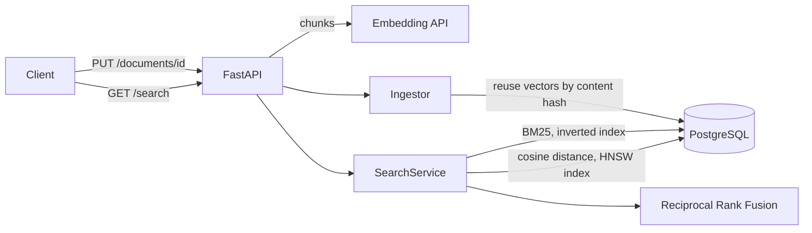

# hybrid-search

[](https://github.com/daen8584-spec/hybrid-search/actions/workflows/ci.yml)

A retrieval service that combines BM25 keyword search with pgvector similarity search, both inside PostgreSQL, and merges the two with Reciprocal Rank Fusion. It is built to be measured: an evaluation command reports nDCG, recall and MRR on a standard BEIR benchmark for each retrieval mode, a sweep measures the recall cost of the approximate vector index, and a load test reports latency percentiles of the running API.

## Features

- **Hybrid retrieval** with keyword, vector and fused modes, collapsed to one result per document, with the rank each retriever assigned to every result
- **BM25 in SQL** over an inverted index in PostgreSQL, with pruning of very common terms to bound query cost
- **Single datastore**: documents, chunks, inverted index and HNSW vector index live in PostgreSQL, updated in one transaction
- **Incremental ingestion**: unchanged documents are skipped, and chunks whose text did not change reuse their stored embedding
- **Any OpenAI-compatible embedding provider**, including a local `llama-server`, with batching, retries, response validation and a query embedding cache
- **Evaluation** on BEIR datasets with nDCG@10, Recall@10, Recall@100 and MRR@10, and latency measured separately from the embedding call
- **Tuning** of HNSW `ef_search` against exact search, and of the fusion weights on a separate query split
- **Load testing** of the HTTP API with p50, p95 and p99 latency and throughput
- **Observability** through JSON logs with request ids and per-request timing
- **Tested** with unit tests and integration tests against PostgreSQL with pgvector in CI, with strict type checking

## Results

Measured on 2026-11-05 on an Android tablet (MediaTek MT8792, 8 GB RAM) under Termux, with PostgreSQL and pgvector on the same device and `nomic-embed-text-v1.5` (Q8_0) served locally by `llama-server`. The dataset is [SciFact](https://github.com/allenai/scifact) from BEIR: 5,183 abstracts, ingested as 5,766 chunks, and 300 test queries.

### Retrieval quality

| Mode | nDCG@10 | Recall@10 | Recall@100 | MRR@10 | p50 | p95 |
| --- | ---: | ---: | ---: | ---: | ---: | ---: |
| Keyword (BM25) | 0.688 | 0.830 | 0.918 | 0.648 | 22.0 ms | 44.2 ms |
| Vector (HNSW) | 0.700 | 0.843 | 0.928 | 0.663 | 16.4 ms | 22.7 ms |
| **Hybrid (RRF)** | **0.719** | **0.847** | **0.958** | **0.684** | 18.3 ms | 27.1 ms |

Hybrid search improves on both retrievers on every metric, most clearly in Recall@100, where the two retrievers find different relevant documents. For reference, the BEIR paper reports nDCG@10 0.665 for BM25 on SciFact.

Latency is retrieval and fusion for the top 100 documents, measured in process with the query embedding already computed. Embedding a query with the local model took a further 100 to 400 ms per query on this device.

### What the first measurement changed

The first evaluation used PostgreSQL's built-in `ts_rank_cd` for keyword ranking and an `ef_search` default of 100:

| Mode | nDCG@10 first | nDCG@10 now | p50 first | p50 now |
| --- | ---: | ---: | ---: | ---: |
| Keyword | 0.399 | 0.688 | 374 ms | 22.0 ms |
| Vector | 0.700 | 0.700 | 40.9 ms | 16.4 ms |
| Hybrid | 0.602 | 0.719 | 386 ms | 18.3 ms |

Keyword ranking had no inverse document frequency and ranked nearly every chunk for every query, and its weak ranking pulled hybrid search below vector search alone. It was replaced with BM25 over an inverted index in PostgreSQL ([0007](docs/adr/0007-bm25-in-postgresql.md)). The first HNSW sweep showed that the query planner had switched to a sequential scan at the old `ef_search` default, so vector search had been exact rather than indexed ([0005](docs/adr/0005-hnsw-index.md)).

### Fusion weight

Chosen on the 809 **train** queries, so that the test queries above were not used for tuning:

| Keyword weight | nDCG@10 | Recall@100 |
| ---: | ---: | ---: |
| 0 (vector only) | 0.725 | 0.940 |
| 0.3 | 0.739 | 0.940 |
| 0.5 | 0.736 | 0.958 |
| 1.0 | 0.738 | 0.956 |

nDCG@10 is flat within 0.005 for weights from 0.2 to 1.0, while Recall@100 improves from 0.4 upward. The default stays at equal weights.

### HNSW recall

| `ef_search` | Recall@10 vs exact | nDCG@10 | p50 | p95 |
| ---: | ---: | ---: | ---: | ---: |
| exact | 1.000 | 0.700 | 44.2 ms | 60.8 ms |
| 10 | 0.907 | 0.688 | 4.7 ms | 6.4 ms |
| 20 | 0.954 | 0.702 | 4.4 ms | 6.2 ms |
| **40 (default)** | 0.987 | 0.700 | 4.8 ms | 6.0 ms |
| 80 | 0.996 | 0.700 | 5.6 ms | 6.8 ms |
| 160 | 1.000 | 0.700 | 6.5 ms | 8.6 ms |

### HTTP API under load

`GET /search` in hybrid mode, 4 concurrent clients, each of the 300 test queries sent once per pass:

| Pass | Throughput | p50 | p95 | p99 | Errors |
| --- | ---: | ---: | ---: | ---: | ---: |
| Cold: query embedded by the model | 3.7 req/s | 1,060 ms | 1,394 ms | 1,702 ms | 0 |
| Warm: query embedding cached | 55.0 req/s | 71.6 ms | 89.2 ms | 102.5 ms | 0 |

With uncached queries, throughput is bounded by the embedding model, which runs on the same CPU and serves one request at a time. The warm pass isolates the service itself: retrieval, fusion and HTTP handling.

Ingesting the corpus embedded about 1.8 million tokens and took about three hours on this device, almost all of it in the embedding model.

## Architecture



Documents are split into chunks along paragraph and sentence boundaries, with overlap between consecutive chunks. Each chunk stores its text, its lexemes (from PostgreSQL's English text search configuration) in an inverted index with term frequencies, and the embedding of the title and chunk text.

A hybrid query runs the keyword search and the vector search concurrently. Each returns its best 100 documents, ranked by their best chunk, and the two lists are fused by rank:

```
score(d) = sum over retrievers r of  weight_r / (60 + rank_r(d))
```

## Design decisions

Significant decisions are documented as [Architecture Decision Records](docs/adr/README.md):

- [0007](docs/adr/0007-bm25-in-postgresql.md) BM25 over an inverted index in PostgreSQL, replacing the full-text ranking of [0002](docs/adr/0002-postgresql-full-text-search.md)
- [0003](docs/adr/0003-reciprocal-rank-fusion.md) Reciprocal Rank Fusion instead of score normalization
- [0004](docs/adr/0004-embedding-model.md) An OpenAI-compatible embedding client and a fixed vector dimension
- [0005](docs/adr/0005-hnsw-index.md) An HNSW index whose recall is measured against exact search
- [0006](docs/adr/0006-synchronous-ingestion.md) Synchronous ingestion with embedding reuse

## API

Errors are returned as `{"detail": ...}`. Every response carries an `x-request-id` header, taken from the request when present. Interactive documentation is served at `/docs`.

| Method | Path | Description |
| --- | --- | --- |
| `PUT` | `/documents/{id}` | Create or replace a document: `{"title": "...", "text": "...", "metadata": {}}`. Returns `201` when created and `200` otherwise, with the chunk counts |
| `DELETE` | `/documents/{id}` | Delete a document and its chunks (`204`, or `404` if it does not exist) |
| `GET` | `/search?q=...&mode=hybrid&limit=10` | Search with `mode` set to `keyword`, `vector` or `hybrid` and `limit` between 1 and 50 |
| `GET` | `/health` | Database connectivity check |

```bash
curl -s -X PUT localhost:8000/documents/aspirin-01 \
  -H 'content-type: application/json' \
  -d '{"title": "Aspirin", "text": "Low dose aspirin reduces the risk of a second heart attack."}'

curl -s 'localhost:8000/search?q=can+aspirin+prevent+heart+attacks&mode=hybrid&limit=5'
```

Example response:

```json
{
  "query": "can aspirin prevent heart attacks",
  "mode": "hybrid",
  "took_ms": 12.4,
  "results": [
    {
      "id": "aspirin-01",
      "title": "Aspirin",
      "snippet": "Low dose aspirin reduces the risk of a second heart attack.",
      "score": 0.0328,
      "keyword_rank": 1,
      "vector_rank": 1
    }
  ]
}
```

## Running locally

Requirements: Python 3.12 or later, PostgreSQL 15 or later with the [pgvector](https://github.com/pgvector/pgvector) extension (0.8 or later), and an OpenAI-compatible embeddings endpoint.

```bash
git clone https://github.com/daen8584-spec/hybrid-search.git
cd hybrid-search
python -m venv .venv && . .venv/bin/activate
pip install -e ".[dev]"
cp .env.example .env
```

Edit `.env` to set `DATABASE_URL` and the embedding settings. To serve `nomic-embed-text-v1.5` locally with llama.cpp:

```bash
llama-server -m nomic-embed-text-v1.5.Q8_0.gguf --embeddings --port 8081 -c 2048 -b 2048 -ub 2048
```

Create the database, apply the schema and start the API:

```bash
createdb hybrid_search
hybrid-search migrate
hybrid-search serve --port 8000
```

### Configuration

| Variable | Default | Description |
| --- | --- | --- |
| `DATABASE_URL` | `postgresql:///hybrid_search` | PostgreSQL connection string |
| `EMBEDDING_BASE_URL` | `http://127.0.0.1:8081/v1` | Base URL of the embeddings API |
| `EMBEDDING_MODEL` | `nomic-embed-text-v1.5` | Model name sent with each request and recorded with each embedding |
| `EMBEDDING_API_KEY` | none | Bearer token, if the provider requires one |
| `EMBEDDING_DIMENSIONS` | `768` | Must match the `chunks.embedding` column |
| `EMBEDDING_QUERY_PREFIX`, `EMBEDDING_DOCUMENT_PREFIX` | `search_query: `, `search_document: ` | Task prefixes for models trained with them |
| `EMBEDDING_BATCH_SIZE` | `16` | Chunks per embedding request |
| `CHUNK_MAX_TOKENS`, `CHUNK_OVERLAP_TOKENS` | `384`, `48` | Chunk size and overlap, in approximate tokens |
| `HNSW_EF_SEARCH` | `40` | HNSW candidate list size per query; see `ann-sweep` |
| `FUSION_KEYWORD_WEIGHT` | `1.0` | Weight of the keyword ranking in fusion, relative to the vector ranking; see `tune-fusion` |
| `LOG_LEVEL` | `INFO` | Log level |

## Evaluation

The evaluation uses [SciFact](https://github.com/allenai/scifact) from the BEIR benchmark: 5,183 scientific abstracts and 300 test queries, each a scientific claim with expert relevance judgements. The dataset is downloaded on demand and is not part of this repository.

```bash
hybrid-search download-beir --name scifact
hybrid-search ingest-beir data/scifact --concurrency 2
hybrid-search eval data/scifact
hybrid-search ann-sweep data/scifact --ef 10,20,40,80,160
hybrid-search tune-fusion data/scifact --split train
```

`ingest-beir` is resumable: documents that are already stored with the same content are skipped. `eval` embeds every query first and then measures retrieval latency per mode with warm query embeddings, so the modes are compared on retrieval cost alone; the embedding latency is reported separately. `ann-sweep` compares HNSW results with exact search for each `ef_search` value. `tune-fusion` evaluates hybrid search for a range of keyword weights on the train split, so that the weight is chosen without looking at the test queries. Every command prints a Markdown table and writes the full results as JSON to `results/`, which is not committed.

To load test the running API:

```bash
hybrid-search serve --port 8000 &
hybrid-search bench data/scifact --mode hybrid --concurrency 8
```

The benchmark sends every test query twice. The first pass includes the query embedding call; the second is served from the query embedding cache, which isolates the cost of retrieval and fusion.

## Testing

```bash
pytest -m "not integration"
createdb hybrid_search_test
pytest -m integration
```

Unit tests cover chunking, fusion, metrics, the dataset loader, configuration and the embedding client, the last against a mocked HTTP transport. Integration tests run ingestion, every search mode and the HTTP API against PostgreSQL with pgvector, using a deterministic hashing embedder in place of a model. They cover embedding reuse, unchanged-document detection, concurrent writes to one document, deletion, BM25 term weighting and index maintenance, agreement between indexed and exact vector search, input validation and the response to an unavailable embedding provider.

The integration tests use `TEST_DATABASE_URL`, which defaults to `DATABASE_URL` with the database name changed to `hybrid_search_test`. They refuse to run against the database named in `DATABASE_URL`, because they truncate its tables. CI runs linting, format checking, strict type checking and both test suites on every push.

## Project structure

```
src/hybrid_search/
  api.py          HTTP API
  chunking.py     Paragraph and sentence aware chunking with overlap
  cli.py          Command-line interface
  config.py       Settings from the environment
  db.py           Connection pool, migrations, pgvector helpers
  embeddings.py   OpenAI-compatible embedding client
  fusion.py       Reciprocal Rank Fusion
  ingest.py       Document ingestion with embedding reuse
  search.py       Keyword, vector and hybrid retrieval
  evaluation/     BEIR loader and retrieval metrics
  migrations/     SQL schema migrations
tests/
  unit/           Tests without external dependencies
  integration/    Tests against PostgreSQL with pgvector
docs/adr/         Architecture Decision Records
```

## Limitations

- Keyword search counts document frequencies at query time and skips chunks that contain only very common query terms. Both are exact or measured at this scale; see [0007](docs/adr/0007-bm25-in-postgresql.md) for what changes at a larger one.
- Token counts used for chunking are approximate and independent of the embedding model's tokenizer. The default chunk size leaves a wide margin below the model's context length.
- The query embedding cache is per process. Several API processes each maintain their own.

## License

[MIT](LICENSE)
